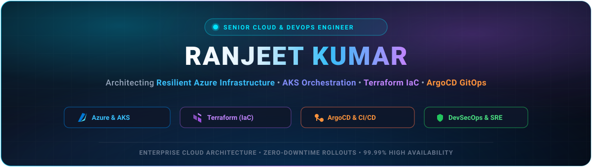

<div align="center">

  <!-- High-Definition Custom Cyberpunk Glassmorphism Banner -->
  <a href="https://github.com/rkumar3008">
    
  </a>

  <!-- Dynamic Typing Subtitle -->
  <a href="https://github.com/rkumar3008">
    
  </a>

  <p align="center">
    <a href="mailto:2ranjeetkr@gmail.com"></a>
    <a href="https://linkedin.com/in/rkumar3008"></a>
    
    
  </p>

</div>

---

### 👨‍💻 About Me

```yaml
professional_profile:
  name: "Ranjeet Kumar"
  role: "Cloud & DevOps Engineer"
  mindset: "Automate everything, secure by design, build for 99.99% availability"
  passions:
    - "Infrastructure as Code (Terraform & Modular Cloud Architectures)"
    - "Kubernetes Container Orchestration (AKS & Microservices)"
    - "Enterprise CI/CD Pipelines (Azure DevOps & GitHub Actions)"
    - "FinOps & Cloud Cost Optimization (Infracost)"
  current_status: "Open to exciting Cloud & DevOps opportunities and impactful engineering collaborations"
```

- 🔭 **Current Focus:** Architecting enterprise-grade **Microsoft Azure** solutions and scaling **Azure Kubernetes Service (AKS)** clusters.
- ⚙️ **Automation & IaC:** Developing reusable, multi-environment **Terraform** modules (Dev, Pre-Prod, Prod) integrated with automated cost and policy checks.
- 🚀 **CI/CD Mastery:** Designing end-to-end **Azure DevOps YAML pipelines** with automated testing, infrastructure validation, and zero-downtime release strategies.
- 🌱 **Continuous Learning:** Exploring Advanced Platform Engineering, SRE reliability practices, and Service Meshes (Istio).
- 💬 **Ask Me About:** Azure Cloud, AKS, Kubernetes manifests, Terraform state management, Docker, NGINX Ingress, Bash & PowerShell automation.
- 📫 **How to reach me:** Drop me an email at [**2ranjeetkr@gmail.com**](mailto:2ranjeetkr@gmail.com) or connect on [**LinkedIn**](https://linkedin.com/in/rkumar3008).

---

### 🛠️ Technical Arsenal & Skills

<table align="center" width="100%">
  <tr>
    <td align="center" width="25%"><strong>Category</strong></td>
    <td align="center" width="75%"><strong>Technologies & Tools</strong></td>
  </tr>
  <tr>
    <td align="center"><strong>☁️ Cloud & Platforms</strong></td>
    <td>
      
      
      
      
      
    </td>
  </tr>
  <tr>
    <td align="center"><strong>☸️ Containers & Orchestration</strong></td>
    <td>
      
      
      
      
    </td>
  </tr>
  <tr>
    <td align="center"><strong>🏗️ Infrastructure as Code</strong></td>
    <td>
      
      
      
      
    </td>
  </tr>
  <tr>
    <td align="center"><strong>🔄 CI/CD & Automation</strong></td>
    <td>
      
      
      
      
    </td>
  </tr>
  <tr>
    <td align="center"><strong>💻 Scripting & Operating Systems</strong></td>
    <td>
      
      
      
      
      
    </td>
  </tr>
  <tr>
    <td align="center"><strong>📊 Observability & Quality</strong></td>
    <td>
      
      
      
      
    </td>
  </tr>
</table>

---

### 🚀 Core Architecture Highlights & Projects

<table>
  <tr>
    <td width="50%">
      <h3 align="center">🌐 Multi-Environment Terraform IaC</h3>
      <p align="center">
        
        
        
      </p>
      <ul>
        <li>Designed modular, DRY architecture for <strong>Resource Groups, Virtual Networks (VNets), Subnets, and Storage</strong>.</li>
        <li>Separated state management across isolated environments (<strong>Dev, Pre-Prod, Prod</strong>) using remote Azure Blob backend with state-locking.</li>
        <li>Integrated automated cost estimation via <strong>Infracost</strong> in the validation pipeline.</li>
      </ul>
    </td>
    <td width="50%">
      <h3 align="center">☸️ Enterprise AKS & Kubernetes Manifests</h3>
      <p align="center">
        
        
        
      </p>
      <ul>
        <li>Configured scalable <strong>Kubernetes Deployments & Services</strong> with automated health checks, replica scaling, and Rolling Updates.</li>
        <li>Implemented <strong>NGINX Load Balancers & Ingress Routing</strong> for zero-downtime traffic distribution and high resilience.</li>
        <li>Followed best practices for resource quotas, secrets management, and container isolation.</li>
      </ul>
    </td>
  </tr>
  <tr>
    <td width="50%">
      <h3 align="center">⚡ Multi-Stage Azure DevOps CI/CD</h3>
      <p align="center">
        
        
      </p>
      <ul>
        <li>Built YAML multi-stage pipelines with automated <code>init</code>, <code>validate</code>, <code>plan</code>, and gated <code>apply</code> phases.</li>
        <li>Implemented selective path triggering (<code>terraform.tfvars</code> changes) and batch branch merging.</li>
        <li>Configured custom self-hosted Linux agents and automated security scanning.</li>
      </ul>
    </td>
    <td width="50%">
      <h3 align="center">🛡️ Cloud Security & Best Practices</h3>
      <p align="center">
        
        
      </p>
      <ul>
        <li>Enforced <strong>Least Privilege RBAC</strong> principles across Azure subscription resources and container workloads.</li>
        <li>Managed sensitive parameters with secure environment variables and Azure Key Vault integration.</li>
        <li>Maintained rigorous version control workflows with clean Git branch strategies and PR reviews.</li>
      </ul>
    </td>
  </tr>
</table>

---

### 📊 GitHub Activity & Analytics

<div align="center">
  <table border="0">
    <tr>
      <td align="center">
        <a href="https://github.com/rkumar3008">
          
        </a>
      </td>
      <td align="center">
        <a href="https://github.com/rkumar3008">
          
        </a>
      </td>
    </tr>
    <tr>
      <td colspan="2" align="center">
        <a href="https://github.com/rkumar3008">
          
        </a>
      </td>
    </tr>
  </table>
</div>

---

### 🤝 Let's Connect & Collaborate!

I am always excited to discuss **Cloud Architecture**, **DevOps best practices**, **Kubernetes orchestration**, or open-source initiatives.

<div align="center">

  [](mailto:2ranjeetkr@gmail.com)
  [](https://linkedin.com/in/rkumar3008)
  [](https://github.com/rkumar3008)

  <br/>
  <br/>

  

  <br/>
  <sub>⚡ <i>"Automate everything, deploy with confidence, engineer for resilience."</i> ⚡</sub>

</div>
